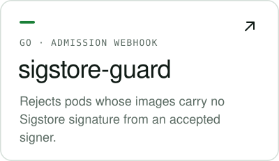
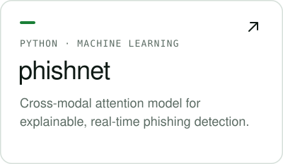

<picture><source media="(prefers-color-scheme: dark)" srcset="assets/hero-dark.svg"></picture>

<b>Read the fixes</b> · <a href="https://github.com/kyverno/kyverno/pull/17608">kyverno#17608</a> · <a href="https://github.com/kedacore/keda/pull/8193">keda#8193</a> · <a href="https://github.com/pipe-cd/pipecd/pull/7412">pipecd#7412</a> · <a href="https://github.com/volcano-sh/volcano/pull/6057">volcano#6057</a> · <a href="https://github.com/pipe-cd/pipecd/pull/7440">pipecd#7440</a> · <a href="https://github.com/kyverno/kyverno/pull/17620">kyverno#17620</a> · <a href="https://github.com/kubeflow/trainer/pull/4155">trainer#4155</a> · <a href="https://github.com/prowler-cloud/prowler/pull/13191">prowler#13191</a> · <a href="https://github.com/kgateway-dev/kgateway/pull/14760">kgateway#14760</a>

Also merged: Kyverno <a href="https://github.com/kyverno/kyverno/pull/17838">#17838</a>, <a href="https://github.com/kyverno/kyverno/pull/17916">#17916</a> and the backports <a href="https://github.com/kyverno/kyverno/pull/17612">#17612</a>, <a href="https://github.com/kyverno/kyverno/pull/18156">#18156</a> · KEDA <a href="https://github.com/kedacore/keda/pull/8213">#8213</a> · PipeCD <a href="https://github.com/pipe-cd/pipecd/pull/7463">#7463</a>, <a href="https://github.com/pipe-cd/pipecd/pull/7477">#7477</a>, <a href="https://github.com/pipe-cd/pipecd/pull/7525">#7525</a>

<b>In review</b> (21 open PRs)

 

- **PipeCD:** restarting piped mid-deployment cancelled it and ran the rollback ([#7443](https://github.com/pipe-cd/pipecd/pull/7443)); one failing cluster cancelled every other target of a multi-cluster stage ([#7495](https://github.com/pipe-cd/pipecd/pull/7495)); a stage's skip config was applied to rollback stages by position ([#7499](https://github.com/pipe-cd/pipecd/pull/7499)); renaming the app config file left every deployment pending forever ([#7501](https://github.com/pipe-cd/pipecd/pull/7501)); plus [#7527](https://github.com/pipe-cd/pipecd/pull/7527) and [#7528](https://github.com/pipe-cd/pipecd/pull/7528)
- **Volcano:** the scheduler config from the v1.15.0 release notes made gang reclaim evict the same job endlessly ([#6046](https://github.com/volcano-sh/volcano/pull/6046)); a negative minResources panicked the scheduler ([#6189](https://github.com/volcano-sh/volcano/pull/6189)); plus [#6002](https://github.com/volcano-sh/volcano/pull/6002), [#6064](https://github.com/volcano-sh/volcano/pull/6064) and [#6120](https://github.com/volcano-sh/volcano/pull/6120)
- **Kyverno:** namespaced policies applied outside their namespace in the CLI ([#17831](https://github.com/kyverno/kyverno/pull/17831)), and skipping VAP generation when an exception needs Kyverno CEL ([#18251](https://github.com/kyverno/kyverno/pull/18251))
- **Kubeflow Trainer:** TrainJobs that pass admission but whose Pods can never start ([#4293](https://github.com/kubeflow/trainer/pull/4293))
- **KubeEdge:** edge nodes discarding still-valid cached service account tokens while offline ([#7306](https://github.com/kubeedge/kubeedge/pull/7306), [#7307](https://github.com/kubeedge/kubeedge/pull/7307))
- **Others:** [kgateway #14749](https://github.com/kgateway-dev/kgateway/pull/14749), [OpenKruise #1001](https://github.com/openkruise/agents/pull/1001), [Prowler #13206](https://github.com/prowler-cloud/prowler/pull/13206), [Trivy checks #657](https://github.com/aquasecurity/trivy-checks/pull/657), [Kubernetes CSI docs #646](https://github.com/kubernetes-csi/docs/pull/646)

 

<a href="https://github.com/harshrajdebug/sigstore-guard"><picture><source media="(prefers-color-scheme: dark)" srcset="assets/card-sigstore-guard-dark.svg"></picture></a>
<a href="https://github.com/harshrajdebug/aws-misconfig-scanner"><picture><source media="(prefers-color-scheme: dark)" srcset="assets/card-aws-misconfig-scanner-dark.svg"></picture></a>
<a href="https://github.com/harshrajdebug/phishnet"><picture><source media="(prefers-color-scheme: dark)" srcset="assets/card-phishnet-dark.svg"></picture></a>

<a href="https://harshrajdebug.in"><picture><source media="(prefers-color-scheme: dark)" srcset="assets/contact-web-dark.svg"></picture></a>
<a href="mailto:harshrajdebug@gmail.com"><picture><source media="(prefers-color-scheme: dark)" srcset="assets/contact-mail-dark.svg"></picture></a>
<a href="https://www.linkedin.com/in/harsh2789"><picture><source media="(prefers-color-scheme: dark)" srcset="assets/contact-in-dark.svg"></picture></a>

